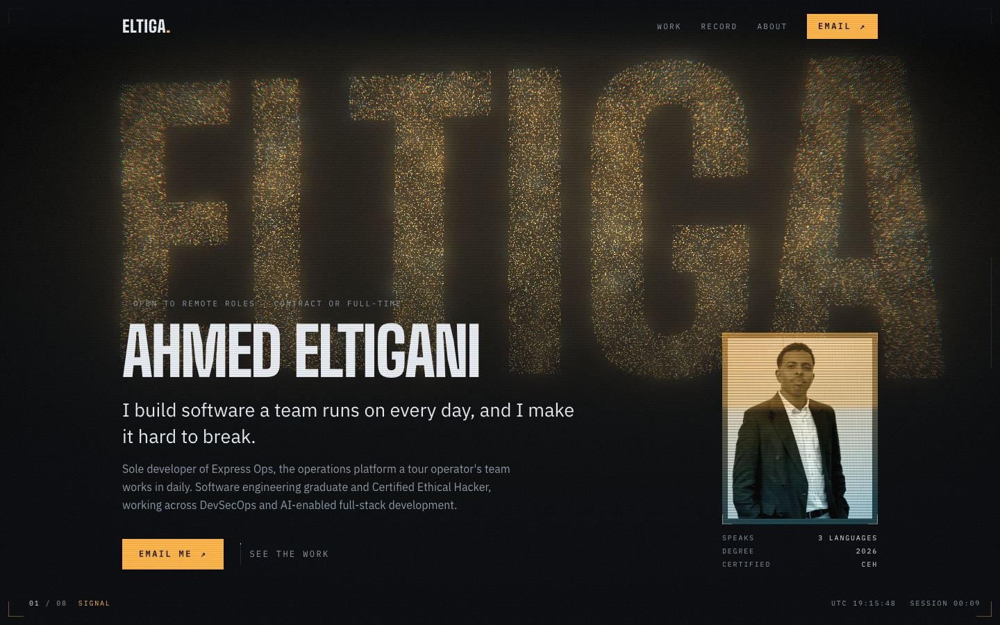
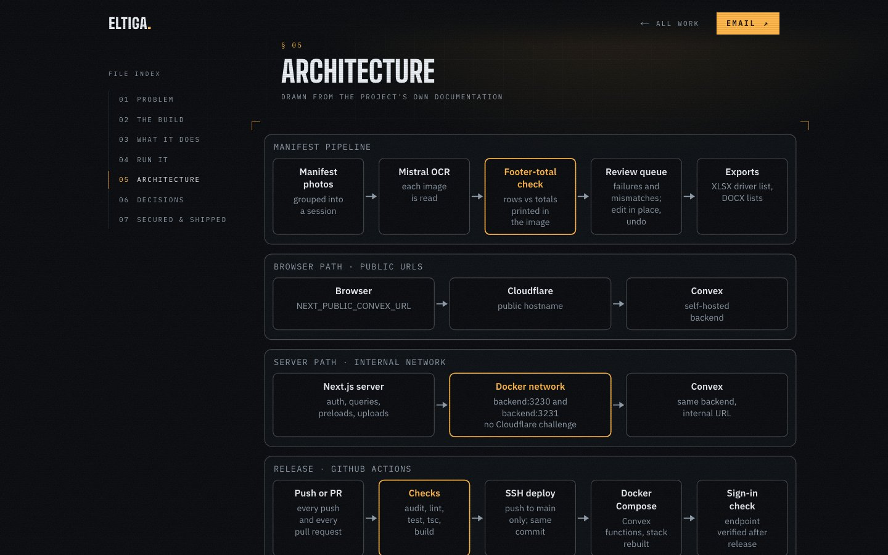
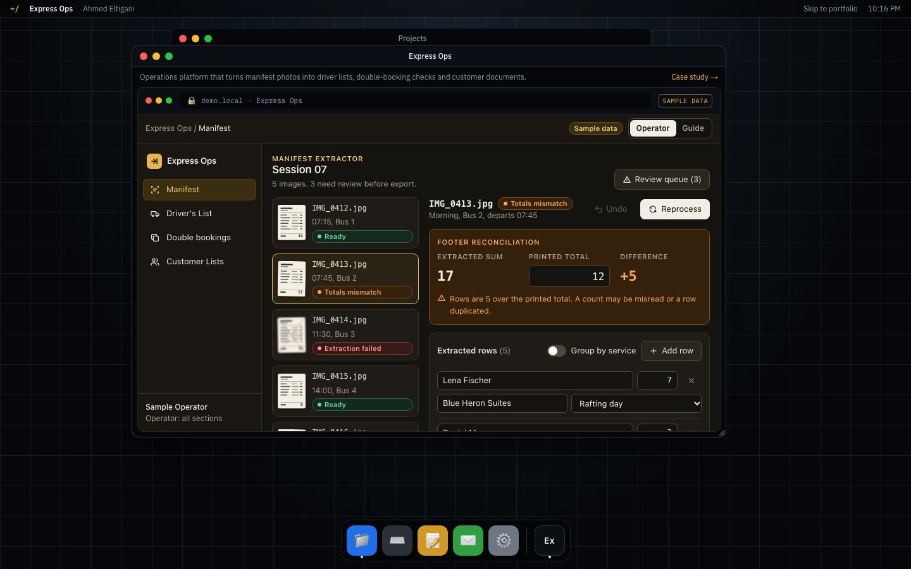
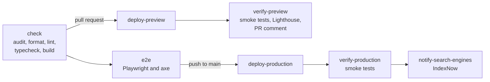

# Ahmed Eltigani · Portfolio

[](https://github.com/ELTIGA/Portfolio/actions/workflows/ci.yml)
[](https://github.com/ELTIGA/Portfolio/actions/workflows/codeql.yml)
[](https://github.com/ELTIGA/Portfolio/actions/workflows/security.yml)
[](LICENSE)

Source code for **[ahmedeltigani.com](https://www.ahmedeltigani.com)**, my personal site: case studies with interactive previews of the products I've built, a macOS-style desktop, a printable résumé and an optional 3D intro. It is built and shipped like production software: typed content, accessibility and performance budgets, and a pipeline that deploys nothing until every check passes.



<table>
  <tr>
    <td></td>
    <td></td>
  </tr>
</table>

## Highlights

- **Interactive case studies.** Each project page (`/work/[slug]`) covers the problem, the build, an interactive preview that runs entirely in the browser on sample data (or a link to the live site), an architecture diagram, the main engineering decisions and how the project is secured and shipped.
- **A desktop in the browser.** `/desktop` has draggable, resizable windows, a dock, a terminal, mail and notes, and every project opens as its own window.
- **Optional 3D intro.** A procedural three.js office whose monitor shows the live desktop. It only appears on capable desktop browsers, can always be skipped, and the regular page stays underneath.
- **Printable résumé.** `/resume` is an ATS-friendly résumé generated from the same content as the rest of the site.
- **Motion with fallbacks.** A WebGL particle field and scroll-driven animation start after first paint, adapt their quality to the device and switch off for reduced motion, save-data and software renderers. All content is server-rendered and readable without JavaScript.
- **Shipping discipline.** Every change passes a dependency audit, formatting, lint, type checks, a production build and end-to-end and accessibility tests before it deploys. Previews also get Lighthouse budgets, and CodeQL, gitleaks and dependency review run on every pull request.

## Tech stack

| Area          | Tools                                                                |
| ------------- | -------------------------------------------------------------------- |
| Framework     | Next.js 16 (App Router), React 19, TypeScript in strict mode         |
| Styling       | Tailwind CSS 4, `next/font` (self-hosted IBM Plex and Big Shoulders) |
| Motion and 3D | three.js, GSAP with ScrollTrigger, Lenis                             |
| 3D intro      | Standalone Vite and three.js app                                     |
| Testing       | Playwright, axe-core, Lighthouse CI                                  |
| Delivery      | GitHub Actions, Vercel, CodeQL, gitleaks, Dependabot                 |

## Getting started

You need Node.js 22 (see `.nvmrc`) and npm.

```bash
git clone https://github.com/ELTIGA/Portfolio.git
cd Portfolio
npm install
npm run dev
```

The site runs at <http://localhost:3000>. The 3D intro is a separate build: run `npm run build:shell` once to serve it in development. Local development needs no environment variables.

### Scripts

| Command               | What it does                                                                 |
| --------------------- | ---------------------------------------------------------------------------- |
| `npm run dev`         | Start the Next.js dev server                                                 |
| `npm run build`       | Build the 3D intro, then the site                                            |
| `npm run build:shell` | Build only the 3D intro into `apps/site/public/experience`                   |
| `npm run format`      | Format everything with Prettier (`format:check` only verifies)               |
| `npm run lint`        | ESLint with the Next.js Core Web Vitals and TypeScript rules                 |
| `npm run typecheck`   | Type-check the site, the content package and the E2E suite                   |
| `npm run test:e2e`    | Playwright and axe against a local `next start` (run `npm run build` first)  |
| `npm run test:smoke`  | Only the `@smoke` tests, e.g. against a deployment with `BASE_URL=https://…` |
| `npm run lhci`        | Lighthouse CI budgets against a local `next start`                           |
| `npm run audit:ci`    | `npm audit` of everything that ships                                         |

Before the first E2E run, install the browser with `npx playwright install chromium`.

## Project structure

```text
apps/
  site/        Next.js app: pages, desktop, interactive previews, diagrams, motion layer
  shell/       3D intro: standalone Vite and three.js app with its own lockfile
packages/
  content/     Typed profile and project data, the single source of truth for all copy
e2e/           Playwright specs: routes, SEO, security headers, desktop, accessibility
scripts/       Builds the 3D intro into the site; submits the sitemap to IndexNow
docs/          Deployment guide and README images
```

## How it works

### Content

All copy lives in `packages/content` as typed data: `profile.ts` for the bio, experience, credentials and metrics, and `projects.ts` with one entry per project. Pages, the desktop, the résumé, the sitemap, the social cards, the JSON-LD and the agent-readable Markdown (`/llms.txt`, `/llms-full.txt` and a `.md` twin of each page, built in `apps/site/lib/markdown.ts`) all read from it, so a project added there appears everywhere. Every claim is first-hand or documented in the project's own repository.

### Interactive previews

Each preview lives in `apps/site/components/demos/<slug>/` and follows the contract in `registry.tsx`: client-only, lazy-loaded and self-contained, with no network calls and only sample data. On case-study pages nothing loads until the visitor launches the preview.

Projects that are live in production set `live` in `projects.ts` instead. They get a self-hosted screenshot that opens the real site in a new tab (`LivePreview.tsx`), since those sites refuse to be framed.

### Motion and effects

The client-only motion layer lives in `apps/site/components/fx/`:

- **`SignalField`** is a three.js particle field (up to 52,000 points, 20,000 on phones) that assembles the handle, becomes a globe past the hero and folds into a radar at the contact section, with all morphing done in the vertex shader. Quality tiers step down automatically when frames run late. It falls back to a static CSS backdrop without WebGL2, on software renderers and low-memory devices, with save-data or with reduced motion. `?gl=1` forces it on and `?gl=0` forces it off.
- **`FxRoot`** syncs Lenis smooth scrolling with GSAP ScrollTrigger and drives data-attribute hooks (`data-reveal`, `data-scramble`, `data-draw`, `data-spine`), so sections stay server components.
- **`Cursor`, `Hud`, `Magnetic`, `HoloCard` and `Counter`** add the reticle cursor, viewport HUD, magnetic buttons, holographic tilt card and odometer numbers.

### 3D intro

`apps/shell` is a standalone Vite and three.js app. `scripts/build-shell.mjs` builds it into `apps/site/public/experience`, and the `Intro3D` component opens it in a full-screen overlay once the page is idle. It only does so for visitors who haven't started scrolling or clicking, on desktop browsers with hardware WebGL2, enough memory and a fast connection. The room is procedural, and the monitor shows the live `/desktop` page.

## Quality and security

- **Tests.** The Playwright specs in `e2e/tests` read their route list from `/sitemap.xml`, so new case studies are covered automatically. They check every route, SEO metadata, security headers, the desktop and the 3D bundle, and run axe accessibility scans. Specs tagged `@smoke` also run against every deployment.
- **Budgets.** Lighthouse CI fails a preview that scores below 95 for accessibility or SEO, or below 90 for best practices, and warns below 85 for performance.
- **Headers.** `apps/site/next.config.ts` sets a strict Content Security Policy, HSTS, `X-Content-Type-Options`, `Referrer-Policy`, `Permissions-Policy` and frame protection.
- **Supply chain.** Third-party actions are pinned to commit SHAs, workflow tokens are read-only by default, and pull requests from forks or Dependabot never receive deploy secrets. `npm run audit:ci` must find no moderate or higher advisory in shipped dependencies. The full audit also lists advisories in dev-only tooling (`eslint-config-next`, `@lhci/cli`) that never reaches the build output.

To report a vulnerability, see [SECURITY.md](SECURITY.md).

## CI/CD

The site is hosted on Vercel, and GitHub Actions is the only way to deploy it: Vercel's Git integration is off (`apps/site/vercel.json`), so nothing ships unless every gate passes.



| Workflow         | Runs on               | What it does                                                                                         |
| ---------------- | --------------------- | ---------------------------------------------------------------------------------------------------- |
| `ci.yml`         | PRs, pushes to `main` | Quality gates, preview and production deploys, post-deploy smoke tests, Lighthouse budgets           |
| `codeql.yml`     | PRs, `main`, weekly   | CodeQL `security-extended` analysis of the JavaScript and TypeScript code                            |
| `security.yml`   | PRs, `main`, weekly   | gitleaks over the full history; dependency review that blocks moderate or higher runtime advisories  |
| `dependabot.yml` | Weekly                | Grouped updates for npm (root and `apps/shell`) and GitHub Actions; `next` and `react` move together |

To deploy your own copy, follow [docs/deployment.md](docs/deployment.md).

## License

The code is released under the [MIT License](LICENSE), with two exceptions:

- **Personal content.** The biography, résumé and case-study text in `packages/content/src/profile.ts` and `packages/content/src/projects.ts`, and the photographs and screenshots in `apps/site/public/images/`, `apps/site/app/og-portrait.jpg` and `docs/images/`, are © Ahmed Eltigani, all rights reserved.
- **Third-party artwork.** The framed prints in `apps/shell/src/posters/` belong to their respective rights holders.

If you build on this project, please replace the content and images with your own.

## Credits

The structure of the 3D intro (camera keyframes, loading screen and the iframe-on-monitor technique) is based on [henryjeff/portfolio-website](https://github.com/henryjeff/portfolio-website) (MIT, © 2024 Henry Heffernan). Only code ideas were reused: the room is built procedurally and no assets were copied. The full notices are in [`apps/shell/LICENSE-THIRD-PARTY.md`](apps/shell/LICENSE-THIRD-PARTY.md), which is also served at `/experience/licenses.txt`.
